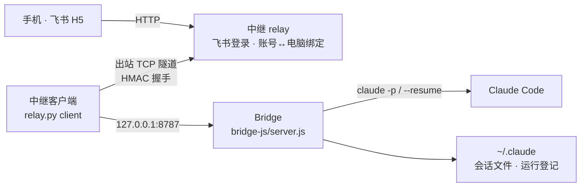
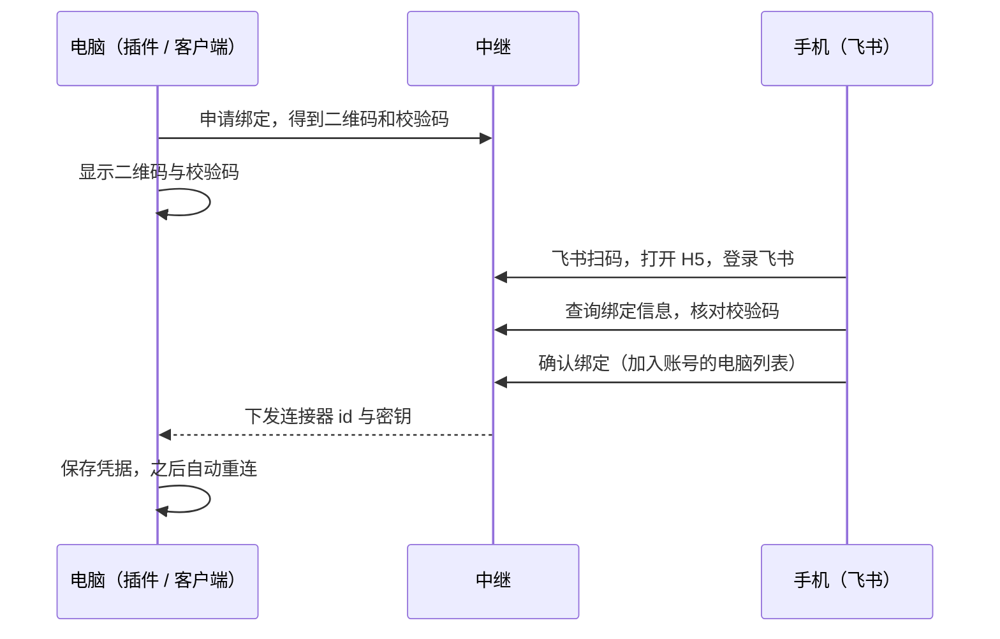

# Agent Bridge

用手机（飞书里的网页）远程查看、驱动你电脑上的 Claude Code：接着 VS Code / 终端里正在进行的会话继续聊，审批工具调用，看代码改动，发图片。

> 非官方项目，与 Anthropic 无关。Claude 是 Anthropic 的商标。

```
手机（飞书 H5）  ──▶  公网中继 relay  ◀── 出站隧道 ──  你的电脑 / 远程开发机：Bridge ──▶ claude
```

## 目录结构

入口脚本留在仓库根目录，实现按功能放进子目录：

```
agent-bridge/
├── relay.py             入口：中继。serve 服务端 / 管理命令（含一份仅供测试使用的 Python 客户端）
├── bridge-js/           Bridge 与中继客户端（Node，只用内置模块，运行在 Claude Code 所在的机器上）
│   ├── server.js          入口：本机 Bridge（HTTP + SSE，监听 127.0.0.1）
│   ├── relay-client.js    中继客户端：绑定、隧道、把任务完成/待审批上报给中继
│   ├── hook-approve.js    PreToolUse Hook 脚本，向 Bridge 请求审批
│   └── lib/               会话列表与多窗口登记、转录渲染、任务执行、审批与差异、命令、二维码
├── relay_lib/           中继的依赖
│   ├── feishu_auth.py     飞书登录、设备与令牌
│   └── qr.py              纯标准库的二维码生成（终端与插件面板用）
├── web/                 手机端 H5：index.html、app.js、markdown.js、style.css
├── deploy/              部署材料：nginx 配置、systemd 服务、启动脚本、上线检查
├── vscode-extension/    VS Code 插件（一键启动、扫码绑定、状态栏）
├── tests/
│   ├── bridge/            对 bridge-js 的集成测试，以及假的 claude
│   ├── relay/             中继、Node 客户端与二维码测试
│   ├── parity/            二维码编码器的 Python / JavaScript 逐项比对
│   └── web/               手机端页面测试（需要 jsdom）
├── Makefile             测试、打包的统一入口
└── README.md  CHANGELOG.md  CONTRIBUTING.md
```

三个运行单元各自独立：**Bridge 与中继客户端**（`bridge-js/`）跑在用户机器上，**中继**（`relay.py` + `relay_lib/` + `web/`）跑在公网服务器上，**插件**（`vscode-extension/`）把前两者在用户机器上一键拉起。用户电脑上只有 Node 版本，由 VS Code 自带的 Node 运行，不需要安装 Python 或 Node；中继在服务器上，用纯 Python 标准库。都没有第三方依赖。

## 背景：遇到的问题

1. **人不在电脑旁，Claude Code 就停住了。** 它在等你审批一次写文件或执行命令，或者你想补一句话，但只能回到电脑前。
2. **开发机没有公网入口。** 代码和 Claude 跑在公司内网、容器或远程服务器上，不能为了手机访问而对外开放端口。
3. **多人使用，账号必须隔离。** 每个人有自己的电脑，一个飞书账号只能看到、操作自己绑定的那些电脑（可以不止一台，比如同时连着几个远程容器）。
4. **自定义 API 用不了官方的远程连接。** VS Code 里的 Claude Code 只有使用官方 API 时才能远程连接（Remote Control）。配置了自定义 API（第三方或自建网关）的用户没有这条路，人一离开电脑就没法继续。
5. **离开电脑就看不到进度。** VS Code 里的会话、Claude 改了哪些代码、贴过的图片，在手机上都没有办法查看，也没法在手机上接着对话。

## 方案

- **Bridge**：跑在 Claude Code 所在的机器上，只监听 `127.0.0.1`。读取本机的 Claude 会话，用 `claude -p` 执行任务，把事件通过 SSE 推给页面，并接管工具调用的审批。
- **中继 relay**：部署在有公网地址的服务器上。负责飞书登录、账号与电脑的绑定、把手机的请求转发进对应电脑的隧道。
- **中继客户端**：跑在用户电脑上，**主动向外**连接中继，所以用户电脑不需要开放任何入站端口。
- **手机端 H5**：由中继提供静态页面，在飞书里打开。
- **VS Code 插件**：把上面“启动 Bridge + 启动中继客户端 + 首次扫码绑定”合成一次安装、自动完成。

## 原理

### 链路与安全边界



- Bridge 只监听本机回环地址；电脑端只做出站连接。
- 每台电脑是一个**连接器**，有自己的 id 和密钥，隧道建立时做 HMAC 握手。
- 一个飞书账号只绑定**一个**连接器，请求只会被转发进该账号绑定的隧道，不会串到别人的电脑。
- 中继对请求体和响应只做转发，不读取、不保存。
- 手机访问 Bridge 用的访问值由连接器密钥派生，中继在转发时换上，手机端拿不到 Bridge 的真实令牌。

### 绑定流程（首次、换电脑）



- 校验码必须和电脑上显示的一致，防止扫到别人的二维码。
- 一个账号可以绑定多台电脑，每台有自己的连接器和密钥，一台电脑只属于一个账号。VS Code 连接不同的远程容器时，每个容器各存一份凭据，对中继来说就是不同的电脑，所以要各扫一次码，互相不会顶掉。
- 电脑在手机上的名字是 `名称@文件夹名`：名称是设置 `agentBridge.computerName`，没填就用主机名（容器的主机名是一串随机字符，**有多窗口需求时强烈建议设置**）。名字只在绑定时上报一次，改名后需要“重新绑定手机”。
- 同一账号下绑定同名电脑时，如果旧的那条当前离线（例如在同一个容器里重新绑定），旧的被撤销并换成新的；同名但在线则两条都保留。
- 手机页面每个请求都带 `X-Relay-Computer: <连接器 id>`，中继核对它确实属于这个账号后才转发，并且不把这个头交给 Bridge。账号只有一台电脑时可以不带；有多台却没带返回 `400 computer_required`，带了别人的返回 `403 computer_not_yours`。电脑超过一台时，侧栏顶部出现电脑切换器（可移除不用的电脑），只有一台时页面和以前一样。
- **多窗口和多电脑是两回事**：

  | 场景 | 凭据存在哪 | 表现 |
  |---|---|---|
  | 同一个环境里开多个 VS Code 窗口（比如本机直装的 VS Code） | 本机插件存储目录，所有窗口共用 | 第一个窗口托管 Bridge，其余作为 guest 登记各自的文件夹，手机上是同一台电脑、会话列表按窗口分组。不用多次扫码 |
  | VS Code 连接不同的远程环境（多个容器、SSH 主机、WSL） | 各环境自己的存储目录，互相独立 | 每个环境是一台独立的电脑，各扫一次码，手机侧栏的切换器里各占一项。互不影响 |

- 接口：`GET /auth/computers` 列出自己的电脑和在线状态，`POST /auth/computers/remove`（body `{"id": "c_xxxxxxxx"}`）移除一台并撤销它的凭据。nginx 白名单已加这两条。

### 任务、权限与审批

手机发出的消息由 Bridge 执行 `claude -p ... --output-format stream-json`，已有会话用 `--resume` 接着聊。Bridge 把事件转成 SSE 推给页面。三种权限模式：

| 模式 | 行为 |
|---|---|
| 询问 `ask` | 改文件、执行命令前，通过 `PreToolUse` Hook 回到 Bridge，在页面上审批；超时或取消按**拒绝**处理 |
| 自动 `auto` | 使用 Claude Code 的 auto 权限模式，不拦截 |
| 只读 `readonly` | 禁用写文件、执行命令类工具 |

审批卡片会展开本次改动的**行级对比**（红删绿增）。`.env`、密钥、证书等敏感文件只显示大小，内容不会发送；其余内容经过关键词脱敏，但脱敏是尽力而为，不是保证。

### 会话同步

- **来源**：本机 `~/.claude/sessions/` 里正在运行的进程（VS Code 面板、终端），加上通过手机发起过的会话；对话内容读自 `~/.claude/projects/` 下的 jsonl。目录可用 `CLAUDE_CONFIG_DIR` 调整。
- **会话名**：与 Claude Code 自己的列表一致。顺序是：手动重命名、自动生成的标题、最近一次提问、摘要、第一句真正输入的话。取名只看会话文件开头和结尾各 64 KB。
- **目录隔离与多窗口**：手机只能看到、续聊“已登记文件夹”下的会话，新会话也只能在这些文件夹里创建。托管 Bridge 的窗口，其文件夹由 `BRIDGE_WORKSPACE` 指定；同一台电脑上打开的其他 VS Code 窗口作为 **guest**，每 15 秒向托管窗口的 Bridge 登记自己的文件夹（`POST /internal/workspace`，用连接器密钥派生的访问值认证，nginx 不放行 `/internal/*`），关闭窗口时注销，超过 45 秒没有心跳也会自动移除。手机左侧的会话列表是两级目录：第一级是窗口（文件夹），其下缩进列出该窗口的会话，没有会话的窗口也会列出。Claude Code 已经关闭（进程已结束）的会话折叠在所属窗口下面的“已关闭 · N”一行里，默认收起，点一下展开；正在查看的会话在折叠里时，折叠会自动展开。手机上发起的会话任务结束后也属于已关闭，所以仍可在这里找到并续聊。同一时间只能选中一个会话；选中会话所在的窗口（或正在为其起草新对话的窗口）前面是绿点，表示当前激活的窗口。点「新对话」在激活的窗口里创建；点某个窗口的标题，则在该窗口里新建对话。同一文件夹开两个窗口时无法区分。
- **托管窗口退出**：托管窗口关闭后 Bridge 随之退出，guest 窗口连续两次心跳失败（约 30 秒）后，由其中一个窗口抢到锁接手托管，其余窗口重新作为 guest 登记。接手期间手机暂时离线，正在运行的任务会中断。
- **编辑器占用**：电脑端正在使用某个会话时，手机发来的消息会排队，等电脑端空闲后送达，避免两个写入方交错。
- **分叉提示**：检测到会话被两处同时写入时，会提示并允许查看旁支。
- **来源标识**：会话来源分为 VS Code、终端、Agent（手机发起）。
- **图片**：会话里的图片在手机上显示；手机端可添加最多 4 张图片，在手机上压缩后发送，Bridge 校验文件头后通过 `--input-format stream-json` 交给 Claude。

### 斜杠命令

手机端输入框里打 `/` 会弹出命令菜单，随输入过滤。命令分两类：

| 命令 | 谁处理 | 说明 |
|---|---|---|
| `/model [名称]` | Bridge | 不带参数弹出选择框；带参数直接设置；`default` 恢复默认。每个会话各存一份，之后每次启动 `claude` 都带 `--model` |
| `/effort [low\|medium\|high\|xhigh\|max]` | Bridge | 同上，对应 `--effort`，`default` 恢复默认 |
| `/clear` | 页面 | 开始新对话，不发给 Claude |
| `/context`、`/compact` | 发给 `claude` | `/context` 由 Claude Code 本地回答，不调用模型、不花钱，输出显示为单独的“命令输出”卡片；`/compact` 需要已有会话 |
| 技能（`/xxx`） | 发给 `claude` | 菜单里列出 Claude Code 报告的用户可调用技能 |

要点：

- **为什么 `/model` 由 Bridge 自己处理**：`claude -p` 里的 `/model` 依赖 `claude` 的版本（实测 2.1.177 返回“isn't available”），而 `--model` / `--effort` 在所有版本上都可用，并且在 `--resume` 时生效、上下文保留。换模型后第一条消息要重新处理整个上下文，会慢一些、费用更高，选择框里有提示。
- **模型名校验**：`claude` 本身不校验（乱写的模型名和强度会被静默接受），所以 Bridge 只放行字母数字加 `. _ : / -` 的名字（可带 `[1m]`），强度只允许上表五档，其余一律 400。
- **可选模型**：内置别名 `default / sonnet / opus / haiku / opusplan / sonnet[1m] / opus[1m]`。想列出自己代理支持的完整模型名，设置环境变量 `BRIDGE_MODELS=名称1,名称2`。没有用 `/v1/models` 自动获取：不少代理只转发主接口，该端点返回 404。
- **当前模型显示**：会话标题下方显示“模型: x”，优先用手机上设置的值，否则显示该会话最近一次实际回答的模型（读自会话文件，电脑端 VS Code 里的回答也算）。
- **未知命令不会发出去**：`claude` 2.1.274 起会把未知的 `/xxx` 当普通消息发给模型，要花一轮费用。页面会先拦下并提示；想发送以 `/` 开头的普通文字，在前面加一个空格。
- **本地命令的输出不在会话记录里**，所以只在这次任务结束时显示一次，刷新后不再出现。
- 技能清单通过一次不落盘的 `claude -p /context` 取得（拿到初始化事件就结束），按目录缓存 10 分钟。

### 机器人通知

手机页「命令与设置」里的「机器人通知」开关,**默认关闭**。打开后,任务完成(运行 20 秒以上)、失败或等待审批时,飞书机器人给你发一条消息,格式如下,点开直接进入对应会话:

```
[my-project] 修复登录 bug
Claude 在等你审批：Bash
https://…/#s=<会话 ID>
```

第一行是**窗口（文件夹名）和会话标题**，由电脑端的中继客户端向本机 Bridge 查询后随事件上报。

- 开关存在中继上,按飞书账号保存,换电脑不丢。
- 中继客户端监听本机 Bridge 的事件流,把「事件类型、工具名、文件夹名、会话标题、会话 ID」用连接器密钥签名后报给中继（60 秒内有效、不可重放，任何字段被改动都会验签失败）;对话、命令、文件内容不会离开电脑，但文件夹名和会话标题会经过中继和飞书。中继检查开关后才调用飞书。
- 按**会话**和类型节流:同一会话同一类消息 60 秒内只发一条(`RELAY_NOTIFY_QUIET`);同一台电脑每 60 秒最多 6 条,多个会话同时结束时超出的会被丢弃(不会合并成一条汇总)。
- 手机页面打开时每 20 秒告诉中继“正在看哪个会话”:正在看的那个会话不发,其他会话照常发;停在会话列表或新对话时全部不发。页面在后台、关闭或断网 45 秒后恢复发送。
- 任务短于 20 秒不发(`RELAY_NOTIFY_MIN_SECONDS`,设在电脑端)。
- 管理员:飞书应用要开通「机器人」能力和 `im:message:send_as_bot` 权限并发布版本,否则发送失败只会记在中继日志里。

### VS Code 插件

插件为 `workspace` 类型，连接远程（SSH、容器、WSL）时装在远端，和 `claude` 命令、会话文件在同一台机器上。打包时把 `bridge-js/` 和 `web/` 原样放进插件的 `runtime/` 目录，用户不需要另外获取 Bridge。Bridge 和中继客户端由 VS Code 自己的程序以 Node 模式（`ELECTRON_RUN_AS_NODE=1`）运行，用户电脑上不需要 Python 或 Node。启动顺序：检查运行环境、检查端口、启动 Bridge、等待 `/healthz`、启动中继客户端；首次没有凭据时用 `--enroll` 并把二维码显示在面板里。插件通过解析中继客户端的输出来识别绑定、运行、认证失败等状态，这部分输出被当作接口，由端到端测试防止改动后失效。

## 使用

### 一、用户：安装插件

要求：Linux、macOS 或 Windows（Windows 需已装 Git for Windows，Claude Code 自己也要它）、已安装并登录 `claude`。不需要安装 Python 或 Node。

1. 拿到 `agent-bridge-x.y.z.vsix`（见下文“打包”），在 VS Code 里执行 `Extensions: Install from VSIX...`，或 `code --install-extension agent-bridge-x.y.z.vsix`。
2. 在设置里填 `agentBridge.relayAddress`（管理员提供，形如 `https://relay.example.com:9010`），或首次启动时按提示输入；打包时指定了默认地址则无需填写。写成 `主机:端口` 是明文连接，仅用于内网或测试，绑定时会有警告。
3. 首次启动会弹出二维码，用飞书扫码，核对校验码后在手机上确认绑定。
4. 之后每次打开 VS Code 自动启动，状态栏左下角显示 Bridge 状态，点击打开菜单。

插件设置：

| 设置 | 默认 | 说明 |
|---|---|---|
| `agentBridge.relayAddress` | 空 | 中继地址：`https://域名[:端口]`（加密，推荐），或 `主机:端口`（明文） |
| `agentBridge.autoStart` | `true` | 启动 VS Code 后自动启动 |
| `agentBridge.computerName` | 空 | 手机上显示为 `名称@文件夹名`，空则名称用主机名。多窗口（尤其是多个容器）请设置 |
| `agentBridge.bridgePort` | `8787` | Bridge 本机监听端口 |
| `agentBridge.claudePath` | 空 | `claude` 路径，空则从 `PATH` 查找 |

命令：`Agent Bridge:` 启动 / 停止 / 重启 / 重新绑定手机 / 显示绑定二维码 / 查看日志 / 检查更新。

### 二、管理员：部署中继

中继必须跑在**有公网地址的服务器**上：手机（飞书）和用户电脑都要能从外网访问它。用户电脑和开发机不需要公网地址。

#### 准备

| 项目 | 要求 |
|---|---|
| 服务器 | 一台有公网 IP 的 Linux 主机（1 核 1 GB 足够），Python 3.8+（Debian 11 / Ubuntu 20.04 起自带），nginx 1.18+ |
| 域名 | 一个解析到该服务器的域名，下文用 `relay.example.com` |
| 证书 | 该域名的 TLS 证书**完整链**和私钥（Let's Encrypt 即可，自签证书会被客户端拒绝） |
| 端口 | 云安全组 / 防火墙放行 TCP **9010**（HTTPS）和 **9011**（隧道 TLS）；**19011 不能对外** |
| 飞书应用 | 在 [飞书开放平台](https://open.feishu.cn/app) 创建企业自建应用，拿到 App ID 与 App Secret |

端口说明：

| 端口 | 谁监听 | 谁访问 | 内容 |
|---|---|---|---|
| 9010 | nginx（HTTPS） | 手机、飞书回调、电脑端首次绑定、插件更新 | 页面与接口，经过白名单、限流 |
| 9011 | `relay.py`（TLS） | 用户电脑上的中继客户端 | 只有隧道协议，不讲 HTTP |
| 19011 | `relay.py`（仅 127.0.0.1） | 本机的 nginx | 中继的 HTTP |

没有开放 9011 时，手机能登录、页面能打开，但看不到会话，会提示“电脑端 Bridge 没有连接”。

#### 1. 配置飞书应用

1. 「安全设置 → 重定向 URL」添加 `https://relay.example.com:9010/auth/feishu/callback`（与下文 `FEISHU_REDIRECT_BASE` 逐字一致，末尾不加 `/`）。
2. 「应用能力」开启**网页应用**；要用机器人通知再开启**机器人**，并申请 `im:message:send_as_bot` 权限。
3. 创建版本并发布，设置可用范围（谁能登录）。

#### 2. 取代码、写配置

下面以 `/opt/agent-bridge` 为目录、`agentbridge` 为运行账号（普通账号，不要用 root）。运行时文件统一放在 `run/`，已被 `.gitignore` 忽略。

```bash
sudo useradd -r -m -s /bin/bash agentbridge        # 已有合适的账号可跳过
sudo git clone https://github.com/starrye/claude-code-bridge.git /opt/agent-bridge
sudo chown -R agentbridge: /opt/agent-bridge
sudo -iu agentbridge
cd /opt/agent-bridge
mkdir -p run && cp deploy/relay.env.example run/relay.env && chmod 600 run/relay.env
vi run/relay.env
```

`run/relay.env` 需要填（值不加引号）：

| 变量 | 示例 |
|---|---|
| `RELAY_STATE` | `/opt/agent-bridge/run/state`（绑定数据，需要备份） |
| `FEISHU_APP_ID` / `FEISHU_APP_SECRET` | 飞书应用凭据 |
| `FEISHU_REDIRECT_BASE` | `https://relay.example.com:9010` |
| `RELAY_TUNNEL_URL` | `tls://relay.example.com:9011` |
| `RELAY_TLS_CERT` / `RELAY_TLS_KEY` | 证书完整链与私钥路径，如 `/etc/nginx/ssl/fullchain.pem`、`/etc/nginx/ssl/privkey.pem` |

证书留在原位，不要复制进项目目录。运行账号要能读私钥：

```bash
sudo chgrp agentbridge /etc/nginx/ssl/privkey.pem && sudo chmod 640 /etc/nginx/ssl/privkey.pem
```

#### 3. 配置 nginx

[`deploy/nginx-agent-bridge.conf`](deploy/nginx-agent-bridge.conf) 是一份**单独的站点文件**，不影响已有站点。需要改三处：`server_name`、证书路径（`ssl_certificate*`）、`/updates/` 的 `root`（改成项目目录）。

```bash
sudo apt install -y nginx
sudo cp deploy/nginx-agent-bridge.conf /etc/nginx/sites-available/agent-bridge
sudo sed -i -e 's#relay\.example\.com#<你的域名>#g' \
            -e 's#/etc/nginx/ssl/fullchain.pem#<证书完整链>#g' \
            -e 's#/etc/nginx/ssl/privkey.pem#<私钥>#g' \
            -e 's#/opt/agent-bridge#<项目目录>#g' /etc/nginx/sites-available/agent-bridge
sudo ln -s /etc/nginx/sites-available/agent-bridge /etc/nginx/sites-enabled/agent-bridge
sudo nginx -t && sudo nginx -s reload
```

这份配置是**白名单**：只放行手机页和电脑端绑定实际用到的接口，并限定方法、请求体大小、限流，其余一律 404，防止外网打到 Bridge 的内部接口。手机页以后新增接口，要同步加一条 `location`。不要在 `sites-enabled/` 里放备份文件，Debian 会全部加载，导致重复定义报错。

#### 4. 用 systemd 启动中继

```bash
sudo cp deploy/agent-bridge-relay.service /etc/systemd/system/
sudo vi /etc/systemd/system/agent-bridge-relay.service   # 核对 User、WorkingDirectory、RELAY_ENV、ExecStart
sudo systemctl daemon-reload
sudo systemctl enable --now agent-bridge-relay
systemctl status agent-bridge-relay                      # 日志：journalctl -u agent-bridge-relay -f
```

#### 5. 验证

在**自己的电脑上**（不是服务器）运行：

```bash
sh deploy/verify.sh relay.example.com
```

它检查证书、隧道地址、白名单、19011 与隧道端口的暴露情况、TLS 版本，全部 PASS 才算部署成功。然后用手机飞书打开 `https://relay.example.com:9010` 应能登录。

#### 6. 给用户的插件

```bash
make vsix RELAY=https://relay.example.com:9010    # 把地址写成插件默认值，用户装上即可扫码
```

把 `vscode-extension/dist/agent-bridge-<版本>.vsix` 发给用户。不写 `RELAY=` 时，用户首次启动时手动输入地址。需要插件自动更新见下文“插件与自动更新”。

#### 更新与维护

- 更新：`git pull && sudo systemctl restart agent-bridge-relay`。页面文件 `web/` 即时生效，Python 代码要重启。
- 证书续期后中继自动加载新证书；nginx 需要 `nginx -s reload`。续期工具可能重置私钥权限，续期后跑一遍 `verify.sh`。
- 私有 CA 签发的证书：在用户电脑上设置 `RELAY_CA_FILE` 指向 CA 证书。
- 管理命令：`python3 relay.py list`、`unbind <id>`、`add-connector --name <名字>`、`pair-code <id>`。
- 备份 `RELAY_STATE` 目录：丢了所有电脑都要重新扫码。

#### 仅开发 / 内网测试：单端口明文

不加 nginx、不加 TLS，隧道和绑定都是明文，客户端会给出警告，**不要用于公网**：

```bash
RELAY_STATE=./state FEISHU_APP_ID=... FEISHU_APP_SECRET=... \
FEISHU_REDIRECT_BASE=http://HOST:9010 \
python3 relay.py serve --listen 0.0.0.0:9010
```

#### 部署排查与安全细节

**排查**

| 现象 | 原因与处理 |
|---|---|
| 手机能登录，但提示“电脑端 Bridge 没有连接” | 没有电脑通过隧道连上来。依次看：云安全组是否放行了 **9011**；电脑上的插件是否是 0.2.0 及以上、状态栏是否“运行中”；服务器 `journalctl -u agent-bridge-relay` 里有没有 `tunnel ready for c_…` |
| `verify.sh` 报隧道端口连不上 | 同上，多半是 9011 没放行，或中继没启动 |
| `verify.sh` 报隧道证书不被信任 | 证书文件不是完整链（缺中间证书），或者是自签证书 |
| 手机登录失败、跳转报错 | `FEISHU_REDIRECT_BASE` 和飞书开放平台里的回调地址不一致（要逐字一致，末尾不加 `/`）；日志里有 `phone login is disabled` 说明飞书的 ID、密钥、回调三项没配全 |
| `nginx -s reload` 后 9010 还是旧中继 | 旧中继没停。`nginx -t` 显示通过不代表端口能绑上，要看 `error.log` 里有没有 `bind() failed`；这时旧配置仍在服务，不影响其他站点，停掉旧中继后再 reload |
| 启动脚本提示 `cannot read the private key` | 运行账号没有私钥的读权限，续期后组权限被改回去时也会这样 |
| 启动脚本提示 `<名字> is not set` | `run/relay.env` 里缺这一项 |

这套部署实际防住的东西（都在 nginx 1.18、真实中继、真实 Bridge 上逐项测过）：

| 威胁 | 做法 |
|---|---|
| 窃听手机到中继、电脑到中继的内容和密钥 | 两段都是 TLS（只留 1.2 / 1.3，前向保密套件，TLS 1.0 / 1.1、静态 RSA、弱套件被拒绝）；客户端校验证书与域名，自签证书默认被拒绝 |
| 绕过 nginx 直接打中继 | 中继 HTTP 只在 127.0.0.1；隧道端口只讲隧道协议，收到 HTTP 直接断开；HTTP 端口收到隧道握手直接断开 |
| 探测内部接口 | 路径白名单只放行手机页和电脑端绑定实际用到的接口，其余一律 404（含 Bridge 的 `/internal/*`、`/history`、`/forks`），路径穿越写法无效 |
| 滥用方法、超大请求 | 每个接口限定方法；除 `/tasks` 外请求体上限 64 KB，`/tasks` 为 10 MB |
| 暴力破解、刷接口 | 登录、配对、绑定、发消息、日常接口各有独立限流；实时推送每个地址最多 5 条；限流按真实客户端地址计，伪造 `X-Forwarded-For` 无效 |
| 慢速攻击 | 请求头 10 秒内必须发完（包括还没读到 `Host` 的连接，由兜底段负责）；半截连接 10 秒断开；握手中的未认证隧道连接有上限 |
| 扫描器 | 用 IP 或别的域名访问直接断开，不返回任何内容；隐藏 nginx 与中继的版本信息 |
| 日志里留下隐私 | 访问日志不记 query、令牌、User-Agent、Referer，会话与任务 ID 打码；错误日志只记 crit 及以上，因为 nginx 的错误日志会写出完整请求行 |
| 上传内容落到磁盘 | 请求体在转发前暂存在内存盘 `/dev/shm`，请求结束即删除；对照实验：去掉这行配置，上传内容会写进真实磁盘 |

注意：

- 排查问题时可以临时把 `error_log` 级别改成 `error`，用完改回来并清掉日志。
- 中继的防暴力破解依赖 `X-Forwarded-For`，所以 nginx 必须和中继在同一台机器上，并且保持配置里 `proxy_set_header X-Forwarded-For $remote_addr;`。
- 页面实际用到的接口在 `deploy/nginx-agent-bridge.conf` 里逐条列出；以后手机页新增接口，要同步加一条 location，否则会被 404。
- 在生产机上用 `nginx -t` 检查后再重载。上线前请在自己的环境里跑一遍 `verify.sh`。

### 三、不用插件，手动运行

手动运行需要 Node 18 或更高版本。

**只想先试 agent 本身（不经过中继，不需要任何公网端口）**：在运行 Claude Code 的机器上启动 Bridge，用浏览器打开它自带的手机页面。图片、代码对比、斜杠命令、切换模型都能测。它只监听本机；验证不了飞书登录和 iPhone 里的实际显示。

```bash
export BRIDGE_TOKEN=$(node -e "console.log(require('crypto').randomBytes(32).toString('base64url'))"); echo "$BRIDGE_TOKEN"
BRIDGE_PORT=8788 BRIDGE_STATE_DIR=/tmp/agent-test node bridge-js/server.js     # 机器上已有插件在用 8787 时换一个端口
# 浏览器打开 http://127.0.0.1:8788 ，把上面打印的令牌粘进去登录
```

**连接中继**：

```bash
# 1. 在运行 Claude Code 的机器上启动 Bridge（令牌至少 24 个字符）
BRIDGE_TOKEN=<随机串> node bridge-js/server.js            # 监听 127.0.0.1:8787

# 2. 连接中继（首次会显示二维码，扫码后凭据保存在 Bridge 状态目录的 relay.env）
node bridge-js/relay-client.js --relay https://relay.example.com:9010 --target 127.0.0.1:8787
```

### 环境变量

| 变量 | 作用 |
|---|---|
| `BRIDGE_HOST` / `BRIDGE_PORT` | Bridge 监听地址，默认 `127.0.0.1:8787` |
| `BRIDGE_TOKEN` | Bridge 访问令牌；未设置时在状态目录自动生成 |
| `BRIDGE_STATE_DIR` | Bridge 与中继客户端的状态目录，默认 `/tmp/claude-bridge-<uid>` |
| `BRIDGE_WORKSPACE` | 把 Bridge 限定在某个目录，只列出、续聊该目录下的会话 |
| `BRIDGE_ALLOWED_ROOTS` | 允许新建会话的额外根目录（按 `:` 分隔） |
| `BRIDGE_APPROVAL_TIMEOUT` | 审批等待秒数，超时按拒绝处理 |
| `CLAUDE_BIN` | `claude` 命令路径 |
| `CLAUDE_CONFIG_DIR` | Claude 配置目录，默认 `~/.claude` |
| `RELAY_STATE` | 中继数据目录 |
| `RELAY_SECRET` | 连接器密钥（由客户端凭据提供） |
| `FEISHU_APP_ID` / `FEISHU_APP_SECRET` / `FEISHU_REDIRECT_BASE` | 中继的飞书登录配置 |

## 开发与测试

```bash
make test               # 后端 + 插件
make test-bridge        # python3 -m unittest discover -s tests -t .（tests/bridge 起 Node 版 Bridge，tests/relay 起 Python 中继）
make test-extension     # node --test（vscode-extension/test）
make test-web           # 手机端页面测试，需要先在仓库根目录 npm install jsdom（node_modules 已被忽略）
```

- 测试从仓库根目录运行；`PYTHON=python3.8 make test-bridge` 可指定解释器。
- 集成测试会真正启动 `bridge-js/server.js` 和 `relay.py`，用 `tests/bridge/fake_claude.py` 代替真实的 `claude`，不调用任何 API。
- `tests/relay/test_node_client.py` 让 Node 客户端连真实的 Python 中继（HTTPS 绑定、TLS 隧道、证书不受信任、密钥错误，以及与 Python 版本一致的事件签名）；`tests/parity/qr_parity.py` 比对二维码编码器的两个实现。
- 中继在 Python 3.8 和 3.10 上都验证过，请保持 3.8 兼容。
- 插件打包脚本不依赖 `vsce`，纯 Python 生成 `.vsix`。

## 打包与发布

`dist/`、`*.vsix`、`*.tgz` 是构建产物，不提交到仓库。

### 中继部署包

```bash
make relay-package        # 产出 dist/agent-bridge-relay.tgz（relay.py + relay_lib/ + web/），并打印 sha256
```

### 插件与自动更新

插件自带更新，不依赖扩展市场，**只在用户主动点“检查更新”时才联网**：启动时不检查，也没有定时检查。管理员发布新版本后通知大家，用户在状态栏菜单（点击左下角 Agent Bridge）或命令面板里选“检查更新”，发现新版本会提示，点“立即更新”后，插件下载安装包、校验、交给 VS Code 安装，然后提示重新加载窗口。Bridge 重启后沿用已保存的凭据，不需要重新扫码。

**更新地址**不用另配：由用户已填的中继地址推出，即 `https://<中继域名>[:端口]/updates/`。只有 `https://` 形式的中继地址才能检查更新。

**安全模型**：服务器上放的文件不被信任，只信任签名。

| 文件 | 内容 |
|---|---|
| `latest.json` | `{"manifest": "<文本>", "signature": "<Ed25519 签名>"}`；清单里是插件名、版本、文件名、sha256、大小 |
| `agent-bridge-X.Y.Z.vsix` | 安装包 |

插件用**内置的公钥**（`vscode-extension/update-public-key.pem`）验证签名，再核对：插件名一致、文件名只能是 `agent-bridge-<清单版本>.vsix`、版本必须更高（回放旧的合法版本无法降级）、下载内容的大小和 sha256 与清单逐字节一致、确实是 zip 压缩包。只走 HTTPS，不跟随重定向，下载大小受清单限制。所以即使有人改了服务器上的文件，也推不出恶意版本；他们没有私钥。

**一次性准备**

```bash
make release-key          # 生成签名密钥：私钥在 ~/.config/agent-bridge/update-private.pem，公钥写入仓库
git add vscode-extension/update-public-key.pem            # 公钥要提交，它随每个安装包发布
```

私钥不能放进仓库（脚本会拒绝），也不会覆盖已有的密钥。**务必备份私钥**：丢了就无法再给已安装的插件推更新，只能让大家手动装一个带新公钥的版本。发布文件放在仓库根目录的 `updates/` 里并**随仓库提交**：服务器上 `git pull` 就完成发布，不用另外传文件。这两个文件都带签名，放进仓库是安全的；每个版本约 100KB，旧版本可以删掉，只留最新的。

**每次发布**

```bash
# 1. 升 vscode-extension/package.json 里的版本号，更新 CHANGELOG.md
make release RELAY=https://relay.example.com:9010
#    产出 updates/agent-bridge-<版本>.vsix 和 updates/latest.json（签名私钥只在做发布的机器上，不进仓库）
git add updates/ vscode-extension/package.json CHANGELOG.md && git commit -m "release: 插件 <版本>" && git push
# 2. 服务器上：cd /opt/agent-bridge && git pull      （中继不用重启）
```

发布后通知大家：在状态栏菜单里点“检查更新”。`RELAY=` 是写进安装包的默认中继地址，市场公开发布时不要写（见下文）。

**限制**

- 已经装了没有更新功能的旧版（0.1.0）的人，需要手动装一次带更新功能的版本，之后才能自动更新。
- “在远程服务器上让扩展安装自己的新版本”这一步依赖 VS Code 的安装命令，尚未在真实的远程环境里验证。如果自动安装失败，插件会提示已校验通过的文件路径，可以在扩展面板选“从 VSIX 安装…”手动装。
- 更新检查直连中继域名，不支持经 HTTP 代理（内网代理环境下检查会失败，只在日志里记录）。
- 只想手动打包不签名时用 `make vsix RELAY=https://relay.example.com:9010`，产出 `vscode-extension/dist/agent-bridge-<版本>.vsix`。

## 已知限制与安全说明

- **只有按“生产部署”的方式部署才是全程加密。** 用 `主机:端口` 形式的地址或单端口的 `--listen` 启动时，隧道和绑定是明文的，客户端会给出警告。
- 中继（`relay.py`）使用了 `fcntl`，只能跑在 Linux / macOS 服务器上；用户电脑上的 Bridge 与中继客户端支持 Windows。Windows 上文件权限（0600）不生效，令牌文件靠用户目录自身的访问控制保护。
- 状态栏“运行中”只表示进程已启动，不保证与中继连通，连接问题看插件日志。
- 同一时间只有一个 VS Code 窗口托管 Bridge（同一个环境里；不同容器、不同主机各自托管各自的 Bridge）。
- 电脑名只在绑定时上报一次，之后换打开的文件夹、改 `computerName` 都不会改变手机上已有的名字，要“重新绑定手机”才更新；改过名再绑定时，旧名字的条目会留下，需要在手机上手动移除。
- 手机上同时只操作一台电脑；切换电脑会换成那台的会话列表和审批，正在另一台上跑的任务不受影响，但不会在当前页面显示。
- 飞书通知里的链接带了电脑 id，已经发出的旧链接（没带电脑）会在当前选中的电脑里找这个会话，找不到就只是打开页面。
- 手机页的自动化页面测试（`tests/web/`）在 jsdom 里跑通，但 iPhone 飞书内置浏览器的实际表现仍需真机验证。

更多变更见 [CHANGELOG.md](CHANGELOG.md)，参与开发见 [CONTRIBUTING.md](CONTRIBUTING.md)。
